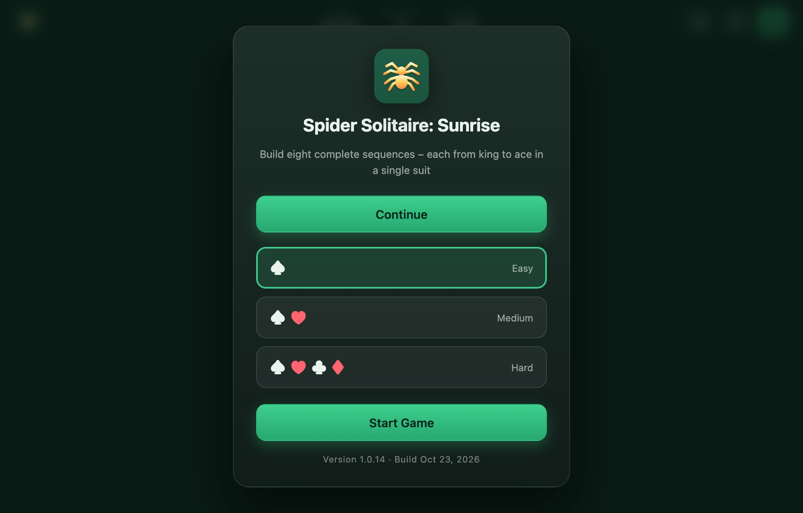
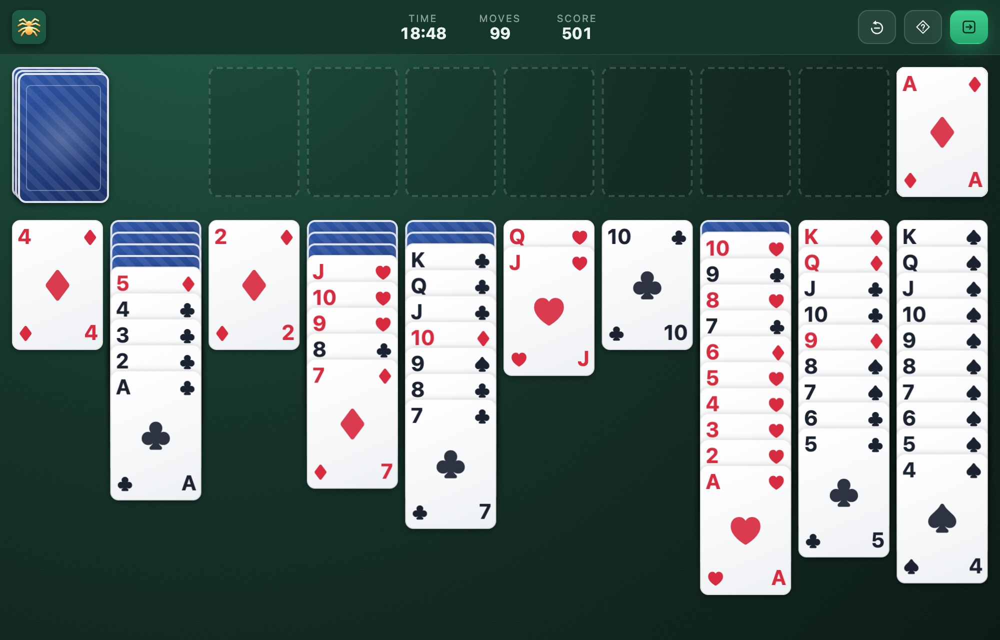
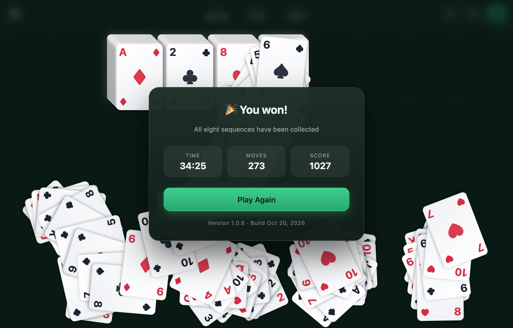

# Spider Solitaire: Sunrise

A classic Spider Solitaire built as a pure HTML/CSS/Vanilla-JS app — no build step, no dependencies. Just open `index.html` in a browser.

The UI is multilingual and automatically picks your browser language. English is the main/fallback language; German, French, Spanish, Italian, Portuguese and Dutch are also included.

## Screenshots

| Start menu | Game in progress | Win screen |
| --- | --- | --- |
|  |  |  |

## How to play

The goal is to build eight complete sequences, each running from **King down to Ace** in a **single suit**. When a full K–A sequence is formed in a column, it is removed automatically and placed in one of the eight foundation frames at the top.

### Setup
- 8 x 13 cards are shuffled and dealt into **10 tableau columns**.
- Each column starts with face-down cards; only the top card is face-up.
- The remaining cards form a **stock** in the top-left corner (5 deals of 10 cards).

### Moving cards
- You can move any **face-up card** (or a stack of face-up cards) onto a column whose top card is **one rank higher**, regardless of suit.
- To move a **group** of cards together, the cards must form a descending run **in the same suit** (for example, 9-8-7 of hearts).
- An empty column can hold any card or valid group.
- When you move the last card off a face-down pile, the next card is revealed automatically.

### Dealing from the stock
- Click the stock pile to deal one card face-up onto each of the 10 columns.
- Dealing is blocked while any column is empty — fill empty columns first.

### Winning
- Clear eight complete K–A single-suit sequences to win.
- After the stock is empty and no face-down cards remain, the game can auto-finish solvable positions for you.

## Controls

| Action | How |
| --- | --- |
| Move cards | Drag and drop, or click for a smart auto-move |
| Deal from stock | Click the stock pile (top-left) |
| Undo | **Undo** button or `Ctrl/Cmd + Z` |
| Hint | **Hint** button |
| End game / new game | **Leave** button (asks for confirmation, then shows the difficulty menu) |

## Difficulty

Choose a difficulty from the start menu:

| Difficulty | Suits | Level |
| --- | --- | --- |
| 1 Suit | ♠ only | Easy |
| 2 Suits | ♠ ♥ | Medium |
| 4 Suits | ♠ ♥ ♦ ♣ | Hard |

## Scoring

- Start with **500 points**.
- Each move costs **1 point**.
- Each completed sequence grants **+100 points**.
- A timer and a move counter are shown in the top bar.

## Languages

The UI detects the browser language on load and falls back to English:

- English (`en`, fallback)
- German (`de`)
- French (`fr`)
- Spanish (`es`)
- Italian (`it`)
- Portuguese (`pt`)
- Dutch (`nl`)

Texts are stored in `i18n.js` (no libraries). Add a new language by extending the dictionary object there; missing keys automatically fall back to English.

## Files

- `index.html` — page structure and static labels
- `i18n.js` — translations
- `version.js` — app version and build date
- `style.css` — styling
- `script.js` — all game logic
- `manifest.json` — PWA manifest (name, icons, colors)
- `sw.js` — service worker for offline caching
- `icons/` — logo and app icons (`favicon.svg`, PNG favicons, `apple-touch-icon.png`, PWA `icon-512.png` / `icon-maskable-512.png`)
- `screenshots/` — images used in this README

## Running

Open `index.html` directly in a browser (double-click or `file://`). No server or installation required. If the favicon looks outdated after a change, do a hard refresh (`Cmd/Ctrl + Shift + R`).

## Install as an app (PWA)

The game is a Progressive Web App: it has a manifest, app icons and a service worker, so browsers can install it as a standalone app icon and it keeps working **offline** afterwards.

Just open the game at [cyberpixelsharc.github.io/spider-solitaire-sunrise](https://cyberpixelsharc.github.io/spider-solitaire-sunrise/) and use your browser's install option below. The browser steps work the same on a phone and on a computer; nothing is typed.

Pick your browser below.

### Chrome / Edge — Windows, macOS, Linux, ChromeOS

- Look for the **install icon** (a monitor with a down-arrow, or a `⊕`/`+`) at the right end of the address bar and click it, then confirm **Install**.
- Or open the **⋮ menu → Cast, save and share → Install page as app…** (Edge: **… → Apps → Install this site as an app**).
- On Android: **⋮ menu → Add to Home screen / Install app**.
- The app then appears in the Start menu / dock / app drawer and launches in its own window.

### Safari — iOS / iPadOS

1. Open the site in Safari.
2. Tap the **Share** button (square with an up-arrow).
3. Scroll down and tap **Add to Home Screen**.
4. Confirm with **Add**. The icon appears on the Home Screen and opens full-screen.

### Safari — macOS (Sonoma or newer)

1. Open the site in Safari.
2. Choose **File → Add to Dock…** (or **Share → Add to Dock**).
3. Confirm. The game is added to the Dock and opens as a standalone window.

### Samsung Internet / other Android browsers

- Open the **⋮ menu** and choose **Add page to → Home screen** (Samsung Internet) or **Install app**.

### Firefox

- **Desktop:** Firefox does not install PWAs as standalone apps. Use Chrome/Edge for that, or drag the page to your desktop/bookmarks as a shortcut.
- **Android:** Firefox removed PWA install support; use **Add to Home screen** for a bookmark shortcut, or install via Chrome instead.

### What you get

- A home-screen / launcher icon using the app artwork.
- A standalone window without the browser UI (where the platform supports it).
- Full offline play after the first visit (assets are cached by the service worker).

While online, the app checks for updates each time it is opened and updates itself automatically once a newer version has been published.

## License

Released under the [MIT License](LICENSE).

