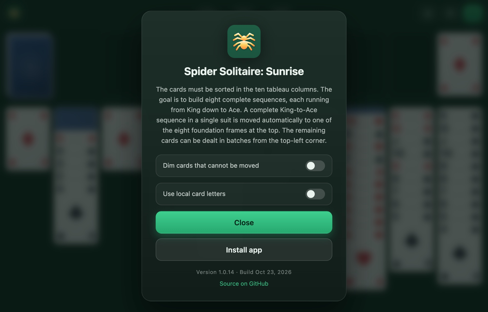

<h1 align="center">Spider Solitaire: Sunrise</h1>

A classic Spider Solitaire built as a pure HTML/CSS/Vanilla-JS app — no build step, no dependencies. Just open <code>index.html</code> in a browser.

The name “Spider” is derived from the eight foundation piles (sequences) that must be formed by the end of the game, which visually resemble the eight legs of a spider.

The cards must be sorted in the ten tableau columns. The goal is to build eight complete sequences, each running from King down to Ace. A complete King-to-Ace sequence in a single suit is moved automatically to one of the eight foundation frames at the top. The remaining cards can be dealt in batches from the top-left corner.

The UI is multilingual (11 languages) and automatically picks your browser language. English is the main/fallback language — German, French, Spanish, Italian, Portuguese, Dutch, Polish, Turkish, Swedish and Czech are also included.

<table>
  <tr>
    <td align="center" width="50%"><strong>Start menu</strong></td>
    <td align="center" width="50%"><strong>Game in progress</strong></td>
  </tr>
  <tr>
    <td width="50%"></td>
    <td width="50%"></td>
  </tr>
  <tr>
    <td align="center" width="50%"><strong>Info dialog</strong></td>
    <td align="center" width="50%"><strong>Win screen</strong></td>
  </tr>
  <tr>
    <td width="50%"></td>
    <td width="50%"></td>
  </tr>
</table>

## History

While the broader category of solitaire- or patience-games has its roots in late 18th-century Europe (likely Germany or Scandinavia), the specific variant known as “Spider Solitaire” is a 20th-century creation from the United States. The precise geographical origin is not fully documented in historical records.

The earliest evidence is considered to be a 1917 book by the renowned American bridge expert Ely Culbertson (*Culbertson's Card Game Complete with Official Rules*), in which the variant and its rules were recorded in writing for the first time.

The game only gained worldwide recognition in the late 1990s, thanks to Microsoft. It was first included in the Plus! 98 expansion pack for Windows 98, and from Windows ME and Windows XP onwards, it became a standard feature of the operating system.

## How to play

The goal is to build eight complete sequences, each running from **King down to Ace** in a **single suit**. When a full K–A sequence is formed in a column, it is removed automatically and placed in one of the eight foundation frames at the top.

### Setup
- 8 x 13 cards are shuffled and dealt into **10 tableau columns**.
- Each column starts with face-down cards — only the top card is face-up.
- The remaining cards form a **stock** in the top-left corner (5 deals of 10 cards).

### Moving cards
- You can move any **face-up card** (or a stack of face-up cards) onto a column whose top card is **one rank higher**, regardless of suit.
- To move a **group** of cards together, the cards must form a descending run **in the same suit** (for example, 9-8-7 of hearts).
- An empty column can hold any card or valid group.
- When you move the last card off a face-down pile, the next card is revealed automatically.

### Dealing from the stock
- Click the stock pile to deal one card face-up onto each of the 10 columns.
- Dealing is blocked while any column is empty — fill empty columns first.

### Winning
- Clear eight complete K–A single-suit sequences to win.
- After the stock is empty and no face-down cards remain, the game can auto-finish solvable positions for you.

### Saving your game

Your game is saved automatically and restored when you reopen the app — the start menu then shows **Continue**. The last chosen difficulty is remembered too. Confirming **Leave** discards the saved game.

## Controls

| Action | How |
| --- | --- |
| Move cards | Drag and drop, or click for a smart auto-move |
| Deal from stock | Click the stock pile (top-left) |
| Undo | **Undo** button or `Ctrl/Cmd + Z` |
| Hint | **Hint** button |
| End game / new game | **Leave** button (asks for confirmation, then shows the difficulty menu) |
| Zoom | Pinch to zoom in and out — double-tap the table area to fit the board to the screen again |
| Long columns | Swipe up or down on the table background or on cards that cannot be moved — tall stacks scroll instead of being squashed |

## Difficulty

Choose a difficulty from the start menu:

| Difficulty | Suits | Level |
| --- | --- | --- |
| 1 Suit | ♠ only | Easy |
| 2 Suits | ♠ ♥ | Medium |
| 4 Suits | ♠ ♥ ♦ ♣ | Hard |

## Scoring

- Start with **500 points**.
- Each move costs **1 point**.
- Each completed sequence grants **+100 points**.
- A timer and a move counter are shown in the top bar.

## Assistance

An optional game aid can dim the cards you cannot move. Open the info dialog by clicking the spider logo in the top-left corner and turn on **Dim cards that cannot be moved**.

- A card can only be lifted together with the cards below it if they form a descending run in the same suit. Cards in the tableau that cannot be lifted this way are darkened slightly.
- The setting is stored in the browser and applies to current and future games. It is off by default.

## High scores

The app keeps a local top-5 list per difficulty (time, moves, score and date of finished games) in your browser — nothing is uploaded.

The win dialog shows the list for the difficulty you just finished, highlights your new entry and tells you when you set a new record.

Clearing your browser data also clears the list.

## Languages

The UI detects the browser language on load and falls back to English:

- English (`en`, fallback)
- German (`de`)
- French (`fr`)
- Spanish (`es`)
- Italian (`it`)
- Portuguese (`pt`)
- Dutch (`nl`)
- Polish (`pl`)
- Turkish (`tr`)
- Swedish (`sv`)
- Czech (`cs`)

Card ranks are shown as A/J/Q/K by default — the info dialog can switch them to the letters common in your language (for example B/D/K in German, V/D/R in French, W/D/K in Polish, Kn/D/K in Swedish).

Texts are stored in `i18n.js` (no libraries). Add a new language by extending the dictionary object there — missing keys automatically fall back to English.

## Files

- `index.html` — page structure and static labels
- `i18n.js` — translations
- `version.js` — app version and build date
- `style.css` — styling
- `script.js` — all game logic
- `manifest.json` — PWA manifest (name, icons, colors)
- `sw.js` — service worker for offline caching
- `icons/` — logo and app icons (`favicon.svg`, PNG favicons, `apple-touch-icon.png`, PWA `icon-512.png` / `icon-maskable-512.png`)
- `screenshots/` — images used in this README

## Running

Open `index.html` directly in a browser (double-click or `file://`). No server or installation required. If the favicon looks outdated after a change, do a hard refresh (`Cmd/Ctrl + Shift + R`).

## Install as an app (PWA)

The game is a Progressive Web App: it has a manifest, app icons and a service worker, so browsers can install it as a standalone app icon and it keeps working **offline** afterwards.

Just open the game at [cyberpixelsharc.github.io/spider-solitaire-sunrise](https://cyberpixelsharc.github.io/spider-solitaire-sunrise/) and use your browser's install option below. The browser steps work the same on a phone and on a computer — nothing is typed.

Pick your browser below.

### Chrome / Edge — Windows, macOS, Linux, ChromeOS

- Look for the **install icon** (a monitor with a down-arrow, or a `⊕`/`+`) at the right end of the address bar and click it, then confirm **Install**.
- Or open the **⋮ menu → Cast, save and share → Install page as app…** (Edge: **… → Apps → Install this site as an app**).
- On Android: **⋮ menu → Add to Home screen / Install app**.
- The app then appears in the Start menu / dock / app drawer and launches in its own window.

### Safari — iOS / iPadOS

1. Open the site in Safari.
2. Tap the **Share** button (square with an up-arrow).
3. Scroll down and tap **Add to Home Screen**.
4. Confirm with **Add**. The icon appears on the Home Screen and opens full-screen.

### Safari — macOS (Sonoma or newer)

1. Open the site in Safari.
2. Choose **File → Add to Dock…** (or **Share → Add to Dock**).
3. Confirm. The game is added to the Dock and opens as a standalone window.

### Samsung Internet / other Android browsers

- Open the **⋮ menu** and choose **Add page to → Home screen** (Samsung Internet) or **Install app**.

### Firefox

- **Desktop:** Firefox does not install PWAs as standalone apps. Use Chrome/Edge for that, or drag the page to your desktop/bookmarks as a shortcut.
- **Android:** Firefox removed PWA install support – use **Add to Home screen** for a bookmark shortcut, or install via Chrome instead.

### What you get

- A home-screen / launcher icon using the app artwork.
- A standalone window without the browser UI (where the platform supports it).
- Full offline play after the first visit (assets are cached by the service worker).

While online, the app checks for updates each time it is opened and updates itself automatically once a newer version has been published. It only reloads when the running page is actually outdated, so an already updated app opens without a second flash.

## License

Released under the [MIT License](LICENSE).

